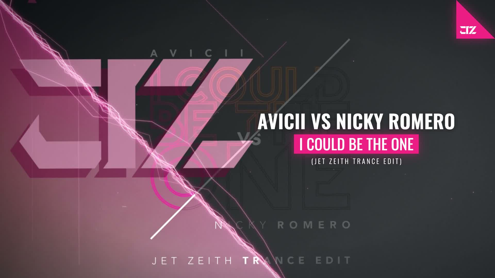

# Visual-Spectre-Revealed-old-style

Audio visualizer in the classic **Revealed Recordings** style, built with **[Remotion](https://www.remotion.dev/)** (React + TypeScript).
Format: **16:9 · 1920×1080 · 60 fps**.



*Single frame of the visualizer: artwork split along a 45° diagonal, a braided spectrum line with outline peaks, a giant tinted logo, and the track title in a neon box.*

## What it does

- **Diagonal spectrum** along a 45° line: a bundle of thin braided strands, outline wires that jump into 45° peaks with the music, and small saw teeth where the sound is loud.
- **Split artwork:** full color on the lit half, darkened and tinted on the other.
- **Drop flood:** a translucent neon haze sweeps over the lit half when a drop starts (detected from the audio).
- **Giant logo** as a tinted window onto the artwork, with a dark copy behind it.
- **2.5D camera:** slow drift and kick pump, with a different parallax depth per layer.
- **Light dust, streaks and shooting lines** that react to the bass.
- **Intro:** loading card with the logo cutting in on the first kick, then a diagonal split reveal and a letter-by-letter text decode.
- **Props in the Studio:** colors, artist, title, subtitle and catalog label are editable from the Remotion Studio.

## Stack

| Tool | Use |
| --- | --- |
| [Remotion 4](https://www.remotion.dev/) | Video as React components, rendering |
| React 19 + TypeScript | Components |
| `@remotion/media-utils` | FFT audio analysis (`useAudioData`, `visualizeAudio`) |
| `@remotion/google-fonts` | Oswald |
| `@remotion/zod-types` + `zod` | Editable props schema |
| `mediabunny` | Reads the audio length to size the composition |

## Project structure

```
src/
  Root.tsx                 composition + default props
  RevealedVisualizer.tsx   scene: layers, camera, intro
  config.ts                geometry, timing, audio calibration
  schema.ts                props schema
  audio/                   spectrum bands, smoothing, kick and drop detection
  components/              Background, DiagonalSpectrum, GiantLogo, LitFlood,
                           HudOverlays, ParticleField, TrackText, Intro, ...
  lib/                     colors, geometry, fonts, text decode
scripts/calibrate-audio.cjs  measures a track and prints the band calibration
```

## Run it

```bash
npm install
npm run dev        # opens Remotion Studio
```

### Assets you need to add

For copyright reasons the track and the cover artwork are **not** included. Put these in `public/`:

- `I Could Be The One [Avicii vs Nicky Romero] Jet Zeith Edit previuw wav.wav` (the audio)
- `fondo youtube 16 9.jpeg` (a 16:9 background image)

Names are set in `src/config.ts` (`ASSETS`). If you use another song, run `node scripts/calibrate-audio.cjs "public/your-track.wav"` and paste the output into `config.ts`.

### Render

```bash
npx remotion render RevealedVisualizer out/video.mp4 --crf=16 --gl=angle
```

`--gl=angle` uses the GPU and makes the render about 3x faster here (about 4 minutes for 2:10 on an Apple Silicon Mac).

## Credits

Made with Remotion. Style inspired by the Revealed Recordings visualizers. The logo is the author's own; the track and artwork belong to their respective owners.
